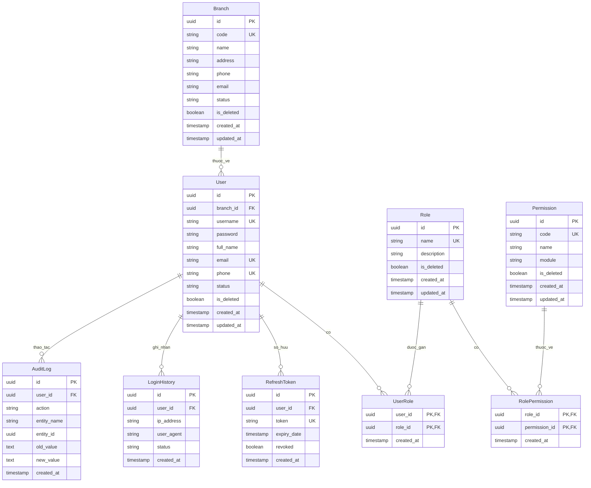
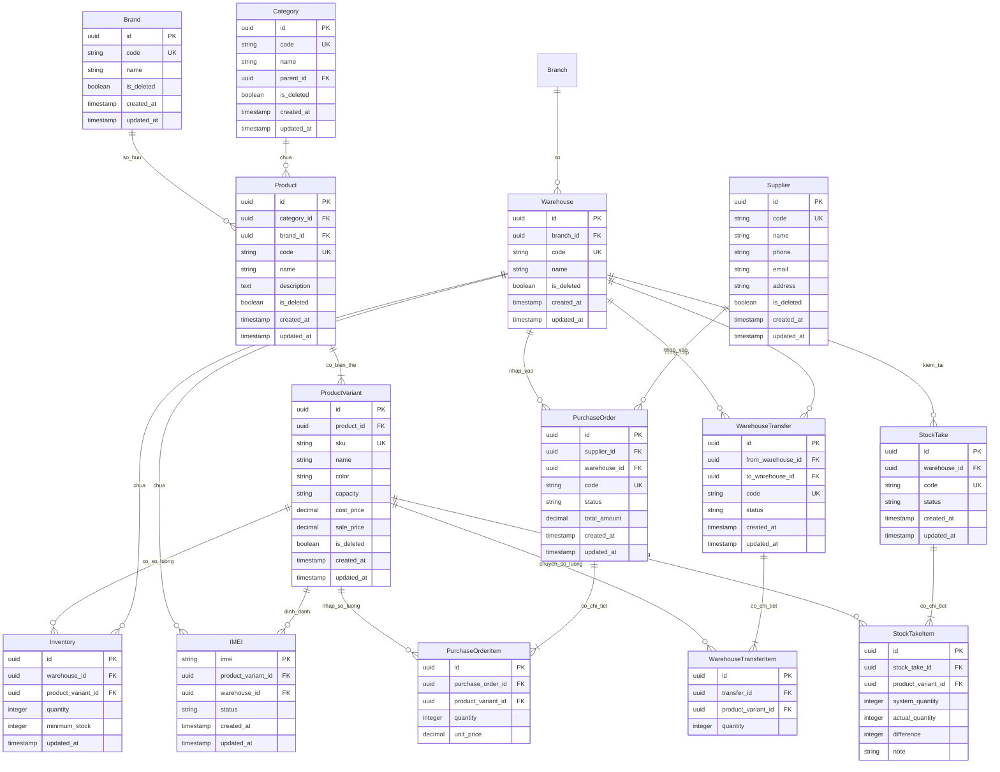
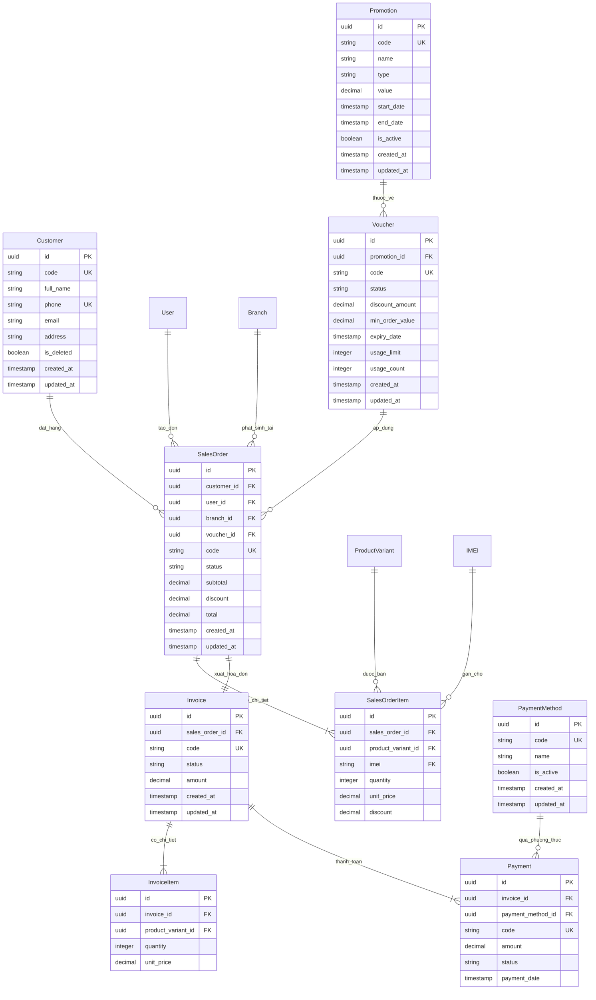
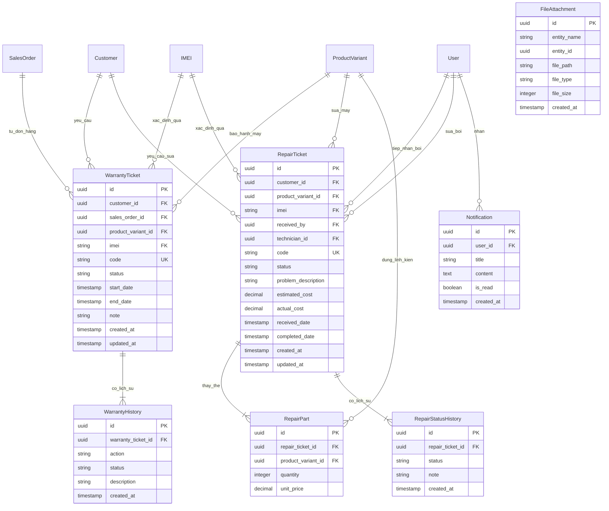
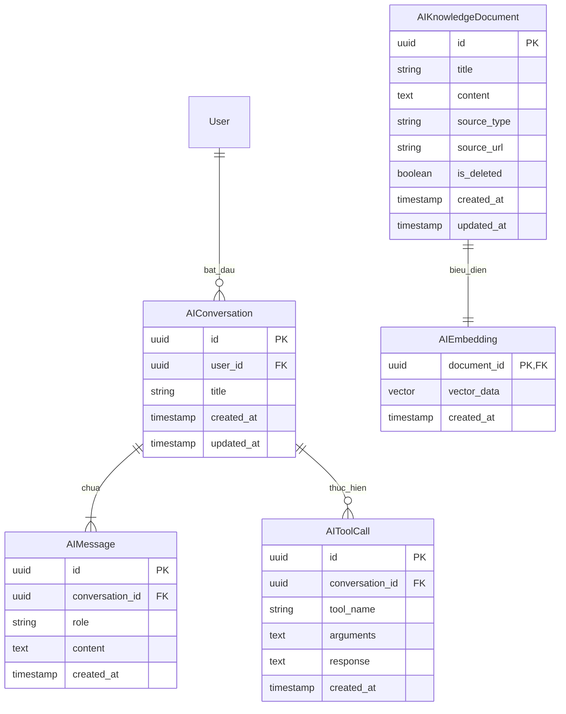

# ENTITY RELATIONSHIP DIAGRAM (ERD)

## Hệ thống quản lý chuỗi cửa hàng điện thoại tích hợp AI Assistant

**Version:** 1.0
**Phase:** 2 - Database Design

---

## 1. Tổng quan
Tài liệu này mô tả chi tiết quan hệ giữa các thực thể (Entity) trong hệ thống thông qua các sơ đồ thực thể liên kết (ERD) bằng ngôn ngữ Mermaid. Để đảm bảo tính trực quan và khả năng theo dõi, ERD được chia thành 5 Bounded Context chính:
1. **Identity & Authorization Context** (Authentication, Authorization, User, Audit Log)
2. **Product Catalog & Inventory Context** (Product, Brand, Category, Warehouse, Inventory, IMEI, Purchase)
3. **Sales & Invoice Context** (Sales Order, Invoice, Payment, Promotion, Voucher)
4. **Service & Repair Context** (Warranty, Repair, File Attachment, Notification)
5. **AI Assistant Context** (Conversation, Message, Tool Call, Knowledge, Embedding)

---

## 2. Quy ước ký hiệu (Crow's Foot Notation)
* `||--o{` : Quan hệ 1 - Nhiều (1 bên bắt buộc, bên nhiều có thể không có)
* `||--|{` : Quan hệ 1 - Nhiều (Cả hai bên đều bắt buộc)
* `|o--o{` : Quan hệ 1 - Nhiều không bắt buộc
* `||--||` : Quan hệ 1 - 1 bắt buộc

---

## 3. Các sơ đồ ERD theo Bounded Context

### 3.1 Identity & Authorization Context
Sơ đồ này quản lý thông tin Nhân viên (`User`), Chi nhánh (`Branch`), Phân quyền (`Role`, `Permission`) và thông tin bảo mật, lịch sử hệ thống.

---

### 3.2 Product Catalog & Inventory Context
Quản lý thông tin Danh mục (`Category`), Thương hiệu (`Brand`), Phiên bản sản phẩm (`ProductVariant`), Kho hàng (`Warehouse`), Tồn kho (`Inventory`), Mã IMEI thiết bị (`IMEI`) và phiếu Nhập hàng (`PurchaseOrder`).

---

### 3.3 Sales & Invoice Context
Quản lý quy trình Bán hàng (`SalesOrder`), Hóa đơn (`Invoice`), Thanh toán (`Payment`) và các chương trình khuyến mãi (`Promotion`, `Voucher`).

---

### 3.4 Service & Repair Context
Quản lý quy trình hậu mãi gồm Bảo hành (`WarrantyTicket`) và Sửa chữa (`RepairTicket`), cùng các dữ liệu bổ trợ như Tệp đính kèm (`FileAttachment`) và Thông báo (`Notification`).

---

### 3.5 AI Assistant Context
Phân hệ quản lý hội thoại của Trợ lý AI (`AIConversation`, `AIMessage`), lịch sử sử dụng công cụ (`AIToolCall`) và dữ liệu tri thức hỗ trợ RAG (`AIKnowledgeDocument`, `AIEmbedding`).

---

## 4. Ràng buộc toàn vẹn cơ sở dữ liệu
* **Xóa mềm (Soft Delete):** Áp dụng cho các thực thể Master Data như `User`, `Branch`, `Customer`, `Product`, `Warehouse`, `Category`, `Brand`, `Supplier`, `AIKnowledgeDocument` bằng trường `is_deleted = true/false`.
* **Ràng buộc khóa ngoại (Foreign Key Constraints):** Mọi bảng con phải có khóa ngoại chỉ đến bảng cha. Khi xóa mềm thực thể cha, thực thể con không bị xóa vật lý nhưng nghiệp vụ truy vấn cần lọc bỏ các thực thể có cha đã bị xóa mềm.
* **Mã định danh (Unique Code):** Các trường như `code`, `imei`, `sku`, `username`, `email`, `phone` bắt buộc phải có thuộc tính `UNIQUE` để tránh trùng lặp thông tin và phục vụ định danh nhanh.
* **IMEI Lifecycle:** Trạng thái IMEI (`status`) chỉ được mang các giá trị hợp lệ: `IN_STOCK` (Trong kho), `SOLD` (Đã bán), `REPAIRING` (Đang sửa), `WARRANTY_HOLD` (Đang giữ bảo hành), `DISPOSED` (Đã thanh lý/đổi máy).
