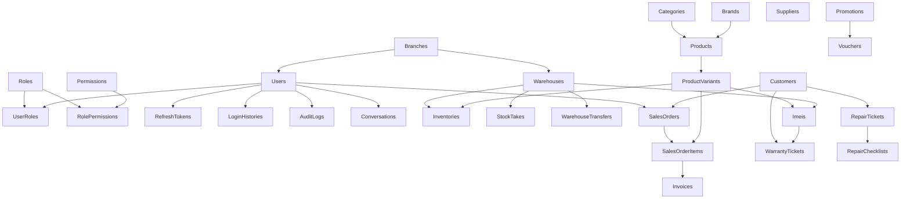

# DATABASE MIGRATION PLAN

## Hệ thống quản lý chuỗi cửa hàng điện thoại tích hợp AI Assistant

**Version:** 1.1 (Cập nhật chuẩn hóa theo .NET 10 & EF Core 10)
**Migration Tool:** Entity Framework Core 10 Code-First Migrations
**Database System:** Microsoft SQL Server 2022 Enterprise
**Phase:** 2 - Database Design

---

## 1. Tổng quan
Hệ thống sử dụng cơ chế **Code-First Migrations** của Entity Framework Core 10 (`Microsoft.EntityFrameworkCore.SqlServer` và `Microsoft.EntityFrameworkCore.Design`) để quản lý toàn bộ vòng đời tiến hóa cấu trúc cơ sở dữ liệu. Tất cả 40 bản di trú (Migrations) được lưu trữ phiên bản kiểm soát nghiêm ngặt trong mã nguồn tại thư mục:
`src/backend/PSP.Infrastructure/Migrations/`

Tiến trình migration đảm bảo tính đồng bộ tuyệt đối giữa mô hình thực thể miền C# (.NET 10) và 49 bảng vật lý trong SQL Server 2022 qua các môi trường: Development (Docker Testcontainers MSSQL), Staging và Production.

---

## 2. Thứ tự Khởi tạo và Phụ thuộc Thực thể (Schema Dependency Sequence)

Do có 72 ràng buộc Khóa ngoại (Foreign Keys) với hành vi `DeleteBehavior.Restrict`, quá trình kiến tạo dữ liệu và migration tuân thủ đồ thị phụ thuộc:



---

## 3. Quy trình Thực thi Migrations trong Dự án

### 3.1 Tạo Migration mới (Developer Workflow)
Khi có sự thay đổi mô hình dữ liệu trong Domain Layer (`PSP.Domain/Modules/`) hoặc cấu hình Fluent API (`PSP.Infrastructure/Data/Configurations/`):

```bash
dotnet ef migrations add <MigrationName>   --project src/backend/PSP.Infrastructure   --startup-project src/backend/PSP.API
```

### 3.2 Áp dụng Migration vào Cơ sở dữ liệu
* **Môi trường Phát triển (Development):**
  ```bash
  dotnet ef database update     --project src/backend/PSP.Infrastructure     --startup-project src/backend/PSP.API
  ```
* **Môi trường Tự động Hóa Kiểm thử (Integration Tests):**
  Kiểm thử tích hợp sử dụng `Testcontainers.MsSql` để tự động khởi tạo container SQL Server 2022 tạm thời và thực thi `context.Database.MigrateAsync()` lúc bootstrap, bảo đảm 259/259 bài test luôn chạy trên cấu trúc CSDL thực tế.
* **Môi trường Production (CI/CD Pipeline):**
  Sinh script SQL migration tự động để kiểm duyệt trước khi chạy trên server:
  ```bash
  dotnet ef migrations script     --idempotent     --project src/backend/PSP.Infrastructure     --startup-project src/backend/PSP.API     --output migrations.sql
  ```

---

## 4. Kiểm soát An toàn và Dự phòng Rủi ro (Resilience Guidelines)
1. **Idempotency Migration Script:** Lệnh sinh script `--idempotent` bao bọc từng bước migration trong khối kiểm tra bảng `__EFMigrationsHistory` để ngăn chặn việc chạy lặp lại gây lỗi.
2. **Khóa Lạc Quan (RowVersion Concurrency Token):** 13 thực thể trọng yếu sở hữu cột `RowVersion byte[] [Timestamp]` để bắt kịp thời các xung đột ghi đồng thời (Concurrency Conflicts) qua `DbUpdateConcurrencyException`.
3. **Sao lưu Dự phòng:** Trước khi áp dụng migration lớn trên Production, thực hiện lệnh Backup Full Database:
   ```sql
   BACKUP DATABASE [PhoneServicePlatform] 
   TO DISK = 'C:\Backups\PSP_PreMigration.bak' 
   WITH FORMAT, INIT, COMPRESSION;
   ```
