# DATABASE MIGRATION PLAN

## Hệ thống quản lý chuỗi cửa hàng điện thoại tích hợp AI Assistant

**Version:** 1.0
**Migration Tool:** Flyway (tích hợp trong Spring Boot 3)
**Database System:** PostgreSQL 16+
**Phase:** 2 - Database Design

---

## 1. Tổng quan
Tài liệu này vạch ra kế hoạch khởi tạo và nâng cấp cơ sở dữ liệu (Database Migration Plan) sử dụng **Flyway** - công cụ di trú dữ liệu tích hợp sâu trong dự án Spring Boot 3 của hệ thống. Nhờ cấu hình di trú tuần tự, dự án sẽ đảm bảo tính đồng bộ dữ liệu giữa các môi trường (Development, Testing, Production) và giảm thiểu rủi ro xung đột cấu trúc bảng khi phát triển đa nhân sự.

---

## 2. Thứ tự khởi tạo bảng (Schema Dependency Sequence)
Do các ràng buộc khóa ngoại (Foreign Keys), việc khởi tạo cấu trúc bảng (DDL) phải tuân thủ nghiêm ngặt trình tự phụ thuộc dưới đây để tránh lỗi vi phạm khóa ngoại trong quá trình chạy Migration:

```mermaid
graph TD
    %% Level 0: Bảng độc lập hoàn toàn
    Branch[branches]
    Role[roles]
    Permission[permissions]
    Category[categories]
    Brand[brands]
    Supplier[suppliers]
    PaymentMethod[payment_methods]
    Promotion[promotions]
    AIKnowledge[ai_knowledge_documents]

    %% Level 1: Phụ thuộc trực tiếp vào Level 0
    Branch --> User[users]
    Role --> UserRole[user_roles]
    User --> UserRole
    Role --> RolePermission[role_permissions]
    Permission --> RolePermission
    User --> RefreshToken[refresh_tokens]
    User --> LoginHistory[login_histories]
    User --> AuditLog[audit_logs]
    User --> AIConvo[ai_conversations]
    Branch --> Warehouse[warehouses]
    Category --> Product[products]
    Brand --> Product
    Promotion --> Voucher[vouchers]
    AIKnowledge --> AIEmbedding[ai_embeddings]

    %% Level 2: Phụ thuộc vào Level 1
    Product --> Variant[product_variants]
    Warehouse --> Inventory[inventories]
    Variant --> Inventory
    Warehouse --> IMEI[imeis]
    Variant --> IMEI
    Supplier --> PurchaseOrder[purchase_orders]
    Warehouse --> PurchaseOrder
    Voucher --> SalesOrder[sales_orders]
    User --> SalesOrder
    Branch --> SalesOrder
    Customer[customers] --> SalesOrder

    %% Level 3: Phụ thuộc vào Level 2
    PurchaseOrder --> PurchaseItem[purchase_order_items]
    Variant --> PurchaseItem
    SalesOrder --> SalesItem[sales_order_items]
    Variant --> SalesItem
    IMEI --> SalesItem
    SalesOrder --> Invoice[invoices]
    SalesOrder --> Warranty[warranty_tickets]
    IMEI --> Warranty
    Customer --> Repair[repair_tickets]
    User --> Repair
    IMEI --> Repair

    %% Level 4: Phụ thuộc vào Level 3
    Invoice --> InvoiceItem[invoice_items]
    Invoice --> Payment[payments]
    PaymentMethod --> Payment
    Warranty --> WarrantyHistory[warranty_histories]
    Repair --> RepairPart[repair_parts]
    Repair --> RepairHistory[repair_status_histories]
    AIConvo --> AIMessage[ai_messages]
    AIConvo --> AITool[ai_tool_calls]
```



---

## 3. Lịch trình File di trú (Flyway Migrations Timeline)
Các file migration được đặt trong thư mục: `src/main/resources/db/migration/` của project Spring Boot. Quy tắc đặt tên tuân thủ: `V<Version>__<Mô_tả>.sql`.

### V1.0__Initial_Schema.sql (Khởi tạo toàn bộ cấu trúc)
Nội dung file này chứa toàn bộ các câu lệnh `CREATE TABLE`, `ALTER TABLE` tạo khóa ngoại và check constraints đã được định nghĩa trong `DATABASE_DICTIONARY.md` và `DATABASE_CONSTRAINT.md`. 
Nội dung file được chia làm các khối lệnh SQL theo đúng thứ tự phụ thuộc nêu ở Mục 2.

### V1.1__Initial_Indexes.sql (Tạo các chỉ mục tăng tốc)
Chứa các lệnh tạo index từ tài liệu `DATABASE_INDEX.md` (bao gồm index khóa ngoại, index tìm kiếm B-Tree và index HNSW cho Vector RAG). Việc tách index sang file riêng giúp kiểm soát và tắt bật index dễ dàng mà không ảnh hưởng tới cấu trúc bảng chính.

### V1.2__Seed_System_Data.sql (Dữ liệu nền tảng ban đầu)
Nạp dữ liệu cơ sở thiết yếu để chạy ứng dụng lần đầu (Chi tiết ở tài liệu `SEED_DATA.md`), bao gồm:
* Kích hoạt quyền (Permissions) mặc định cho hệ thống.
* Tạo vai trò (Roles: Admin, Manager, Cashier, Inventory, Technical).
* Tạo tài khoản quản trị tối cao (Admin User) mặc định liên kết chi nhánh chính.
* Cấu hình các phương thức thanh toán khả dụng.

---

## 4. Quy trình triển khai Migration (Deployment Flow)

### 4.1 Môi trường Phát triển (Local / Development)
1. **Cấu hình Spring Boot application.yml:**
   ```yaml
   spring:
     datasource:
       url: jdbc:postgresql://localhost:5432/phone_store_db
       username: postgres
       password: yourpassword
     flyway:
       enabled: true
       baseline-on-migrate: true
       baseline-version: 0
   ```
2. Khi khởi chạy dự án (`mvn spring-boot:run` hoặc click run trong IDE), Flyway tự động đối chiếu các file `.sql` trong classpath và database, sau đó thực hiện migrate những thay đổi chưa được áp dụng.

### 4.2 Môi trường Kiểm thử & Production
* **Nguyên tắc không chỉnh sửa file migration cũ:** Khi một file migration đã được deploy lên Testing hoặc Production, **tuyệt đối không chỉnh sửa nội dung file đó**. Nếu cấu trúc database thay đổi, bắt buộc phải tạo một file migration mới với phiên bản tăng dần (ví dụ: `V1.3__Add_new_column_to_customers.sql`).
* **Sao lưu tự động (Backup):** Trước khi chạy các tiến trình migration lớn trên Production, hệ thống CI/CD kích hoạt lệnh sao lưu nhanh (Database Snapshot) sử dụng `pg_dump` để đề phòng trường hợp lỗi phát sinh.

---

## 5. Kế hoạch khôi phục khi gặp sự cố (Rollback & Failure Recovery Plan)
Khi một file migration chạy bị lỗi giữa chừng, Flyway sẽ ghi nhận trạng thái `FAILED` vào bảng quản trị `flyway_schema_history` và chặn đứng mọi hoạt động khởi động của ứng dụng Spring Boot.

### 5.1 Quy trình sửa đổi lỗi Migration
1. **Xác định lỗi:** Đọc log khởi chạy của Spring Boot để tìm chính xác lỗi cú pháp SQL hoặc vi phạm ràng buộc dữ liệu thực tế.
2. **Khôi phục thủ công (Rollback):** Do PostgreSQL hỗ trợ Transactional DDL, hầu hết các lệnh lỗi trong file migration sẽ tự động được rollback. Trường hợp ngoại lệ cần can thiệp thủ công:
   * Chạy script rollback tương ứng bằng công cụ quản trị (e.g. pgAdmin, DBeaver) để đưa database về trạng thái của version trước đó.
   * Xóa bản ghi bị lỗi trong bảng lịch sử Flyway:
     ```sql
     DELETE FROM flyway_schema_history WHERE success = false;
     ```
3. **Cập nhật lại file SQL:** Sửa lỗi trong file `.sql` đang phát triển và khởi chạy lại dự án Spring Boot để Flyway thực thi lại.
4. **Đối với Production:** Sử dụng công cụ của Flyway Command Line hoặc viết script migration bù đắp (để drop/alter ngược lại) thay vì sửa đổi file cũ trực tiếp.
