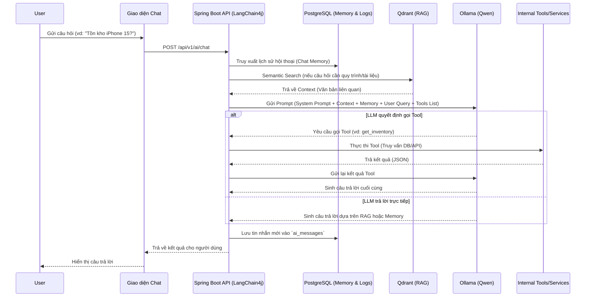

# AI ARCHITECTURE DESIGN

## Hệ thống quản lý chuỗi cửa hàng điện thoại tích hợp AI Assistant

**Version:** 1.0
**Phase:** 5 - AI Design

---

## 1. Tổng quan Kiến trúc AI (AI Architecture Overview)
Hệ thống AI Assistant được thiết kế dựa trên kiến trúc **Agentic RAG (Retrieval-Augmented Generation kết hợp Tool Calling)**. Trợ lý ảo không chỉ có khả năng trả lời câu hỏi dựa trên tài liệu nội bộ (RAG) mà còn có khả năng tương tác với dữ liệu thời gian thực thông qua việc gọi các hàm nghiệp vụ (Tool Calling).

## 2. Các Thành phần Cốt lõi (Core Components)

### 2.1 Orchestration Framework: LangChain4j
LangChain4j đóng vai trò là nhạc trưởng điều phối toàn bộ luồng xử lý AI trong Spring Boot, bao gồm:
* Quản lý hội thoại (Chat Memory).
* Tích hợp Embedding Model và Vector Database.
* Định tuyến (Routing) và thực thi Tool Calling.
* Giao tiếp với Local LLM.

### 2.2 LLM Provider: Ollama (Qwen)
Sử dụng **Ollama** triển khai mô hình **Qwen** (ví dụ: `qwen2.5:7b` hoặc `qwen2.5:14b`) tại server cục bộ (On-premise) nhằm:
* Bảo mật tuyệt đối dữ liệu doanh nghiệp, không rò rỉ thông tin ra internet.
* Tốc độ phản hồi cao trong mạng nội bộ.
* Qwen hỗ trợ tiếng Việt xuất sắc và khả năng Tool Calling mạnh mẽ.

### 2.3 Vector Database: Qdrant
Lưu trữ các vector nhúng (Embeddings) của tài liệu nội dung nghiệp vụ, chính sách bảo hành, thông số kỹ thuật. Qdrant cung cấp khả năng tìm kiếm ngữ nghĩa cực nhanh (Semantic Search).

### 2.4 Dữ liệu Nghiệp vụ: PostgreSQL
Lưu trữ lịch sử hội thoại (`ai_conversations`, `ai_messages`), nhật ký dùng tool (`ai_tool_calls`) và toàn bộ dữ liệu nghiệp vụ theo cấu trúc thiết kế ở Phase 2.

## 3. Luồng Xử lý Dữ liệu (Data Flow)

## 4. Tích hợp Bảo mật và Phân quyền
* **Data Access Control:** Các Tool được cung cấp cho AI sẽ tự động lấy `UserContext` từ JWT Token của phiên làm việc. AI chỉ có thể tra cứu và thao tác trên dữ liệu mà nhân viên đó được cấp quyền.
* **Read-Only Default:** Phần lớn các hành động của AI là truy vấn (Read). Các hành động thay đổi dữ liệu (Write/Update) nếu có sẽ yêu cầu cơ chế "Human-in-the-loop" (Hiển thị nút xác nhận trên UI để nhân viên duyệt trước khi thực thi).
