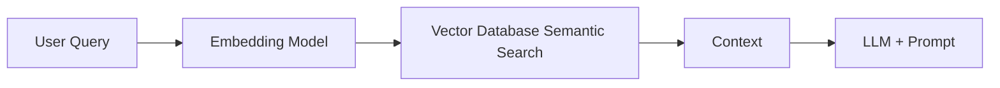

# RAG DESIGN (Retrieval-Augmented Generation)

## Hệ thống quản lý chuỗi cửa hàng điện thoại tích hợp AI Assistant

**Version:** 1.0
**Phase:** 5 - AI Design

---

## 1. Mục đích của RAG trong hệ thống
RAG được sử dụng để cung cấp tri thức nội bộ cho AI mà không cần phải fine-tune (huấn luyện lại) mô hình LLM.
Các loại tri thức được xử lý bởi RAG:
* Sổ tay hướng dẫn nghiệp vụ, quy trình (SOP).
* Chính sách bảo hành, đổi trả, ưu đãi.
* Tài liệu về thông số kỹ thuật sản phẩm (Mặc dù sản phẩm có thể truy xuất qua Tool, nhưng các bài viết hướng dẫn sử dụng, mô tả dài cần RAG).
* Các quy định về nhân sự và quy tắc giao tiếp.

## 2. Quy trình RAG (RAG Pipeline)

### 2.1 Quá trình Ingestion (Nạp dữ liệu)
```mermaid
graph LR
    A[Tài liệu PDF, Word, Markdown] --> B[Document Loader]
    B --> C[Document Splitter (Chunking)]
    C --> D[Embedding Model]
    D --> E[(Vector Database - Qdrant)]
```
* **Document Loader:** Sử dụng `FileSystemDocumentLoader` của LangChain4j.
* **Document Splitter:** Sử dụng `DocumentByParagraphSplitter` hoặc `DocumentBySentenceSplitter`. Kích thước chunk (Chunk size) khuyến nghị là **500 - 800 tokens** với khoảng lặp (overlap) là **50 - 100 tokens** để giữ nguyên ngữ cảnh giữa các đoạn.
* **Embedding Model:** Biến đổi text thành các vector số (xem chi tiết tại `EMBEDDING_DESIGN.md`).
* **Lưu trữ:** Đẩy vectors cùng với payload (metadata như `title`, `source`, `category`) vào Qdrant.

### 2.2 Quá trình Retrieval (Truy xuất dữ liệu)

* Khi người dùng đặt câu hỏi, câu hỏi được chuyển thành Vector.
* Thực hiện thuật toán **Cosine Similarity** hoặc **Dot Product** trong Qdrant để tìm top-k (thường k = 3 hoặc 5) chunks giống nhất.
* Lấy Text của các chunks này nhét vào phần `[CONTEXT]` trong Prompt.

## 3. Cấu hình LangChain4j Content Retriever

Sử dụng cơ chế `EmbeddingStoreContentRetriever` tích hợp sẵn trong LangChain4j:

```java
@Configuration
public class RagConfig {
    @Bean
    public ContentRetriever contentRetriever(EmbeddingStore<TextSegment> embeddingStore, 
                                             EmbeddingModel embeddingModel) {
        return EmbeddingStoreContentRetriever.builder()
                .embeddingStore(embeddingStore)
                .embeddingModel(embeddingModel)
                .maxResults(5) // Lấy 5 đoạn văn bản liên quan nhất
                .minScore(0.7) // Ngưỡng độ tin cậy tối thiểu
                .build();
    }
}
```

## 4. Tối ưu hoá RAG (Advanced RAG)
Để tăng độ chính xác trong truy xuất văn bản tiếng Việt:
* **Query Transformation (Viết lại câu hỏi):** Dùng một LLM prompt nhỏ gọn gàng lại câu hỏi của người dùng cho rõ nghĩa trước khi Embedding.
* **Hybrid Search (Tìm kiếm lai):** (Tương lai) Kết hợp Semantic Search của Qdrant và Full-text Search (BM25) để vừa bắt ngữ nghĩa vừa bắt chính xác từ khóa (keyword).
* **Metadata Filtering:** Khi tìm kiếm, có thể lọc trước (Pre-filtering) theo metadata. Ví dụ nhân viên hỏi về bảo hành, hệ thống sẽ lọc bộ tài liệu có metadata `category = "warranty"` trước khi tính độ tương đồng vector.
