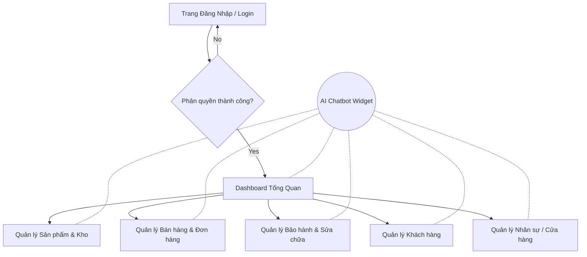

# SCREEN FLOW

## Hệ thống quản lý chuỗi cửa hàng điện thoại tích hợp AI Assistant

**Version:** 1.0
**Phase:** 6 - UI Design

---

## 1. Tổng quan luồng màn hình (General Screen Flow)
Luồng màn hình được thiết kế theo hướng "Single Page Application (SPA)" kết hợp với "Floating AI Assistant". Điều này có nghĩa là, trên bất kỳ màn hình nghiệp vụ nào, nhân viên cũng có thể gọi trợ lý ảo ra hỗ trợ mà không cần chuyển trang.

## 2. Biểu đồ Screen Flow (Sitemap)

## 3. Luồng Chi tiết theo Phân hệ

### 3.1 Luồng Quản lý Bán hàng (Sales Flow)
1. **Màn hình POS (Point of Sale):** Giao diện quét mã vạch sản phẩm, tìm kiếm khách hàng bằng số điện thoại.
2. **Chi tiết Đơn hàng:** Hiển thị danh sách sản phẩm đã chọn, chọn chương trình khuyến mãi (voucher, giảm giá).
3. **Thanh toán:** Chọn hình thức thanh toán (Tiền mặt, Chuyển khoản, Quẹt thẻ), kết nối xuất hoá đơn điện tử.
4. **Hoàn thành:** In biên lai, điều hướng về màn hình POS hoặc xem chi tiết.

### 3.2 Luồng Quản lý Kho (Inventory Flow)
1. **Danh sách Tồn kho:** Hiển thị grid/bảng tồn kho, lọc theo chi nhánh/SKU.
2. **Nhập kho / Chuyển kho:** Tạo phiếu chuyển, duyệt phiếu chuyển giữa các chi nhánh.
3. **Kiểm kê:** Cập nhật số lượng thực tế, xử lý chênh lệch.

### 3.3 Luồng Tương tác AI (AI Interaction Flow)
1. User nhấn vào biểu tượng Robot ở góc phải màn hình.
2. Sidebar/Popup AI trượt ra. User gõ câu hỏi: "Tạo giúp anh đơn hàng cho anh Nguyễn Văn B mua iPhone 15".
3. AI phản hồi hiển thị nội dung chat.
4. AI có thể trả về một thẻ (Card/Widget) với nút "Xác nhận tạo đơn".
5. User nhấn "Xác nhận", hệ thống điều hướng thẳng đến màn hình Chi tiết Đơn hàng với dữ liệu đã được điền sẵn.
